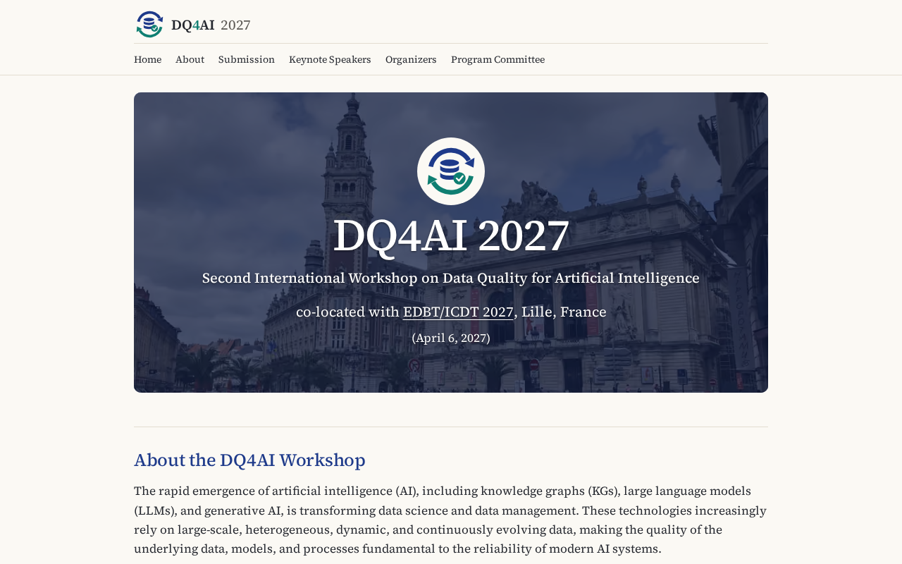

# DQ4AI 2027 website

[](https://github.com/dq4ai/dq4ai-2027/actions/workflows/ci.yml)
[](https://github.com/dq4ai/dq4ai-2027/actions/workflows/deploy.yml)

Website of the Second International Workshop on Data Quality for Artificial Intelligence, co-located
with EDBT/ICDT 2027 in Lille, France.

**Live site:** <https://dq4ai.github.io/dq4ai-2027/>



## The site

The site is one page, laid out like the previous edition's site,
[QuaLLM-KG 2026](https://quallmkg2026.github.io/), with this edition's content. Nothing folds away,
and the site is always light.

- **Banner:** "DQ4AI 2027" in large type, then "Second International Workshop on Data Quality for
  Artificial Intelligence", "co-located with EDBT/ICDT 2027, Lille, France" and "(April 6, 2027)".
- **Sections**, each with its title above it and ending on "Go to top ↑": About the DQ4AI Workshop,
  Topics of Interest (each topic a heading over bullet points), Submission (paper categories,
  important dates, submission details), Program, Keynote Speakers, Organizers (with the contact) and
  Program Committee.
- **Menu:** Home, About, Submission, Program, Keynote Speakers, Organizers and Program Committee.
- **Footer:** one line, "© DQ4AI 2027 — All rights reserved".

The old page addresses (`/call-for-papers/`, `/attend/` and so on) send visitors to the matching
section.

## Update the content

Everything on the site comes from `src/content/`, and no code changes are needed. See the
[content guide](docs/CONTENT_GUIDE.md). Invalid content, such as a notification date before the
submission deadline, fails the build with a message naming the file and field, and the live site
stays as it was.

## Develop

Requires Node 22.23.4 (see `.nvmrc`) and pnpm.

```sh
pnpm i && pnpm dev
```

| Command                            | Does                                                      |
| ---------------------------------- | --------------------------------------------------------- |
| `pnpm build`                       | Builds to `dist/`, lists remaining TBAs                   |
| `pnpm build:fixture`               | Builds the populated test site                            |
| `pnpm lint` / `pnpm check`         | ESLint and Prettier / types                               |
| `pnpm test`                        | Unit tests                                                |
| `pnpm test:e2e`                    | Browser and accessibility tests, both sites (build first) |
| `pnpm validate:html` / `pnpm lhci` | HTML validity / Lighthouse budgets                        |

## Documentation

- [Content guide](docs/CONTENT_GUIDE.md), for co-chairs
- [Architecture](docs/ARCHITECTURE.md), with decisions and dependencies
- [New edition](docs/NEW_EDITION.md), for rolling to next year

## License

Code under MIT, content under CC BY 4.0, and the fonts under the SIL Open Font License. See [LICENSE](LICENSE).
